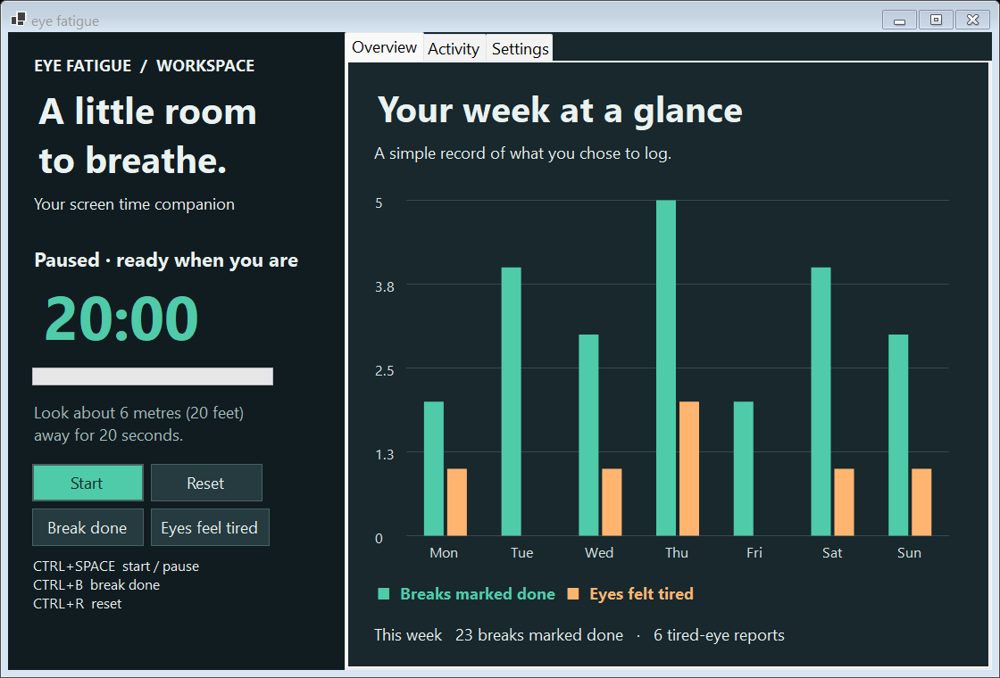
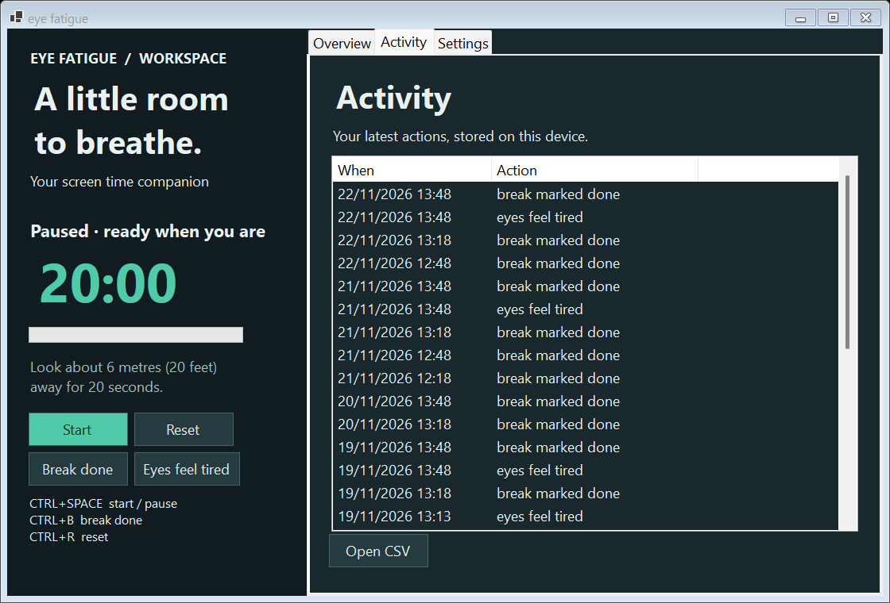
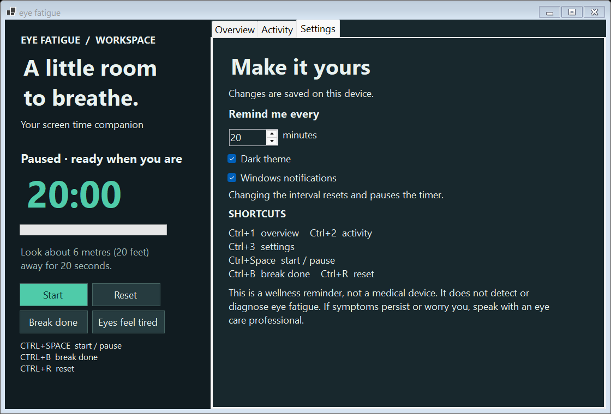

# eye fatigue

staring at a screen for a while? this app gives you a nudge to look away and take a break. it has a little workspace for your timer, activity and settings, and everything stays on your pc.



## what it does

- reminds you to take a break (20 minutes by default, or pick 5–120)
- lets you pause, reset, mark a break done or say your eyes feel tired
- shows your last seven days of breaks and tired-eye reports in a graph
- keeps a local activity list you can open as a csv
- lets you resize the panes, switch themes and turn notifications on or off

The graph counts what you logged; it doesn't measure eye fatigue. The screenshots use sample activity.




## get started

You need Windows and the [.NET 10 SDK](https://dotnet.microsoft.com/download/dotnet/10.0). Open PowerShell in this folder and run:

```powershell
powershell -NoProfile -ExecutionPolicy Bypass -File .\scripts\run.ps1
```

Press **Start** when you're ready. The default reminder is to look about 20 feet (6 metres) away for 20 seconds. Press **Break done** when you're finished to start the next interval. Changing the interval or resetting pauses the timer, so press Start again.

Drag the divider to resize the panes. Your pane width, interval, theme and notification preference are saved for next time. Keep the app open for reminders; closing it stops the timer. Windows can also hide notifications when Do Not Disturb is on or notifications are disabled.

| shortcut | action |
| --- | --- |
| Ctrl+1 / 2 / 3 | overview / activity / settings |
| Ctrl+Space | start or pause |
| Ctrl+B | mark break done |
| Ctrl+R | reset timer |

## activity and privacy

Activity and settings are stored in `%LOCALAPPDATA%\EyeFatigue\`. The activity tab shows the latest 100 entries, and **Open CSV** opens the full history. You can delete `activity.csv` whenever you want. It contains timestamps and actions such as reminders and self-reported tired eyes. The app doesn't use the camera or send your data anywhere.

## a quick note

This is a wellness reminder, **not a medical device** or a validated fatigue detector. It can't tell whether you're looking at the screen or whether you took a break. The original OpenCV experiment in `eye-fatigue/` is separate from the app; finding a face or failing to find an eye isn't enough to determine eye closure or fatigue. It needs proper validation before it can support those claims.

If symptoms persist or worry you, speak with an eye care professional. The papers behind the reminder and its limits are in [research.md](research.md).

## building and testing

```powershell
powershell -NoProfile -ExecutionPolicy Bypass -File .\scripts\build.ps1
powershell -NoProfile -ExecutionPolicy Bypass -File .\scripts\test.ps1
```

GitHub Actions runs the build and clock checks on Windows for pushes and pull requests. To refresh the screenshots with sample data, build first and run `powershell -NoProfile -ExecutionPolicy Bypass -File .\scripts\screenshots.ps1` in an interactive Windows session.
